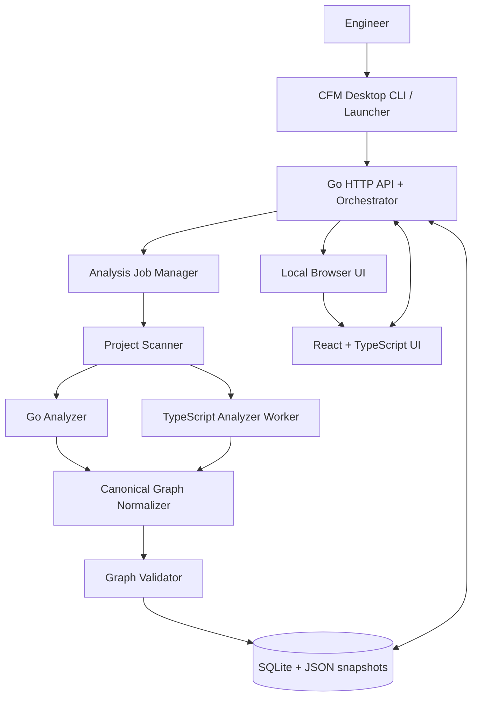
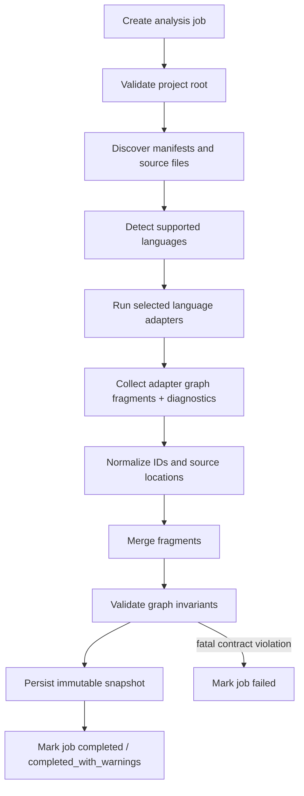

# Codebase Flow Mapper — System Architecture

**Version:** 1.0  
**Status:** Proposed implementation baseline  
**Applies to:** MVP (Go + TypeScript, local-first)

## 1. Purpose and architectural constraints

This document turns the PRD, ADRs, and Graph Schema into a buildable system design.

### Non-negotiable constraints

1. The application runs locally and serves its UI over loopback only.
2. The application does not execute the target project's application code.
3. The application does not install target-project dependencies or run arbitrary lifecycle scripts.
4. Go and TypeScript analyzers emit the same versioned canonical graph contract.
5. The frontend consumes canonical graph/API DTOs, never native AST or compiler objects.
6. Both Mind Map and Flowchart are projections of the same graph snapshot.
7. AI is not in the critical path and cannot mutate graph facts.
8. Every graph relationship retains evidence, resolution state, and confidence metadata.
9. Analysis must be useful when partial: diagnostics explain missing dependencies, unsupported constructs, and unresolved calls.

## 2. System context



### Runtime model

- `cfm` is the primary executable and owns the lifecycle.
- The Go process binds an ephemeral or configured `127.0.0.1` port, writes the selected URL to stdout, and opens the default browser only when explicitly enabled or requested by the launcher.
- Static frontend assets are embedded in the Go binary for distribution.
- TypeScript analysis is performed by a bundled, version-pinned Node worker. The worker communicates with the Go orchestrator over stdin/stdout using newline-delimited JSON (NDJSON). It is not exposed as a network service.
- Go analysis runs in-process through Go packages and `golang.org/x/tools`.
- SQLite stores project metadata, analysis-job metadata, and snapshot indexes. Full graph snapshots are versioned JSON files in an application-owned data directory. A database row points to each snapshot.
- The application must support a mode that prints the URL without opening a browser, for CI and remote-development environments.

## 3. Component responsibilities

| Component | Responsibility | Must not do |
|---|---|---|
| CLI / launcher | Parse flags, validate root path, start server, optionally open browser | Parse source code or execute project scripts |
| HTTP API | Validate requests, authorize local project access, return DTOs | Perform long-running analysis synchronously |
| Orchestrator | Coordinate scan, analyzers, normalization, validation, persistence | Contain language-specific AST rules |
| Project scanner | Discover files, manifests, ignore rules, language roots | Follow symlinks outside approved root by default |
| Go adapter | Discover Go symbols, routes, calls, control flow and evidence | Emit UI-specific node positions |
| TS worker | Discover TS symbols, framework routes, calls, control flow and evidence | Send source contents to external services |
| Graph normalizer | Convert adapter output to canonical schema | Guess unresolved relationships as resolved |
| Graph validator | Enforce schema invariants and referential integrity | Silently repair invalid graph facts |
| Graph query service | Traverse, filter, expand, find paths and callers/callees | Reimplement language semantics |
| Snapshot repository | Persist immutable graph snapshots and metadata | Store absolute paths in portable exports by default |
| Web UI | Search, inspect, visualize, navigate source, show diagnostics | Infer call relationships from labels or layout |
| Export service | Export graph JSON and optional diagnostics | Leak local absolute paths unless explicitly requested |

## 4. Recommended repository layout

Use a monorepo. Keep language-specific analyzers isolated behind adapter contracts.

```text
codebase-flow-mapper/
├── AGENTS.md
├── README.md
├── PRD.md
├── ARCHITECTURE.md
├── GRAPH_SCHEMA.md
├── ADR.md
├── SPRINT_BACKLOG.md
├── IMPLEMENTATION_GUIDE.md
├── CODING_STANDARDS.md
├── TESTING_STRATEGY.md
├── go.mod
├── cmd/
│   └── cfm/
│       └── main.go
├── internal/
│   ├── app/                 # lifecycle and dependency wiring
│   ├── config/              # CLI and runtime configuration
│   ├── httpapi/             # handlers, middleware, DTOs
│   ├── project/              # project registry and scanner
│   ├── analysis/
│   │   ├── jobs/             # job state machine and cancellation
│   │   ├── pipeline/         # orchestration stages
│   │   ├── adapters/         # adapter interfaces and registry
│   │   ├── goanalyzer/       # Go-native analysis implementation
│   │   ├── tsworker/         # Node worker process management
│   │   └── normalize/        # adapter output -> canonical graph
│   ├── graph/
│   │   ├── model/            # canonical graph structs
│   │   ├── validate/         # schema and semantic validation
│   │   ├── query/            # traversal and path algorithms
│   │   └── view/             # UI projection DTOs
│   ├── persistence/
│   │   ├── sqlite/
│   │   └── snapshots/
│   ├── security/             # path policy, origin/host checks
│   ├── export/               # graph export
│   └── diagnostics/
├── workers/
│   └── typescript/
│       ├── package.json
│       ├── tsconfig.json
│       └── src/
│           ├── main.ts
│           ├── protocol/
│           ├── project/
│           ├── analyzer/
│           └── fixtures/
├── web/
│   ├── package.json
│   ├── src/
│   │   ├── app/
│   │   ├── api/
│   │   ├── components/
│   │   ├── features/
│   │   │   ├── projects/
│   │   │   ├── analysis/
│   │   │   ├── graph/
│   │   │   ├── mindmap/
│   │   │   ├── flowchart/
│   │   │   └── source/
│   │   └── types/
│   └── vite.config.ts
├── schema/
│   ├── graph.schema.json
│   ├── adapter-result.schema.json
│   └── worker-protocol.schema.json
├── testdata/
│   ├── go/
│   └── typescript/
├── scripts/
└── docs/
```

The layout is normative for ownership boundaries, not a requirement to create every directory in Sprint 1. Avoid empty package proliferation; create packages when their first task is implemented.

## 5. Analysis pipeline



### Pipeline stage contracts

1. **Input:** project root, include/exclude patterns, analysis mode, framework hints, build configuration.
2. **Discovery:** deterministic file inventory; respect `.gitignore` where practical plus CFM-specific excludes; always exclude VCS metadata, build outputs, vendored dependencies, and configured generated folders by default.
3. **Language detection:** detect `go.mod` / `go.work` and `tsconfig.json` / package manifests. Do not assume every `.ts` file is part of the same TS program.
4. **Adapter execution:** each adapter returns a graph fragment, toolchain metadata, and diagnostics. An adapter can return partial results.
5. **Normalization:** stable IDs, normalized project-relative paths, canonical node/edge types, confidence, evidence.
6. **Merge:** deduplicate symbols and edges by stable identity; retain multiple evidence locations where meaningful.
7. **Validation:** reject invalid references and malformed graph structures; emit diagnostics for recoverable semantic uncertainty.
8. **Persistence:** atomically write snapshot to a temporary file, fsync where supported, then rename; commit metadata only after successful snapshot write.
9. **Query:** UI fetches root summaries and expands subgraphs on demand instead of loading an unbounded graph at startup.

## 6. Adapter contract

Each analyzer adapter must implement a language-neutral contract. The Go implementation may be an in-process interface; the TS worker implements the same logical contract over NDJSON.

```go
type AnalyzerAdapter interface {
    ID() string
    Version() string
    Detect(ctx context.Context, project ProjectDescriptor) (Detection, error)
    Analyze(ctx context.Context, req AnalysisRequest) (AdapterResult, error)
}
```

`AdapterResult` contains:
- adapter ID and version;
- language/toolchain version;
- graph fragment using the canonical schema types or a strictly mapped intermediate representation;
- diagnostics;
- statistics;
- completeness flags (for example, package load partial, type information unavailable).

The worker protocol must include `protocolVersion`, `requestId`, `operation`, and `payload`. Every response includes the same `protocolVersion` and `requestId`, `status`, and either `result` or a structured `error`. Stdout is reserved for protocol messages; logs go to stderr. A worker crash or malformed response becomes a diagnostic and a failed adapter result, not a process-wide panic.

## 7. Go analyzer design

### Tooling

- `go/parser` and `go/ast`: syntax and declarations.
- `go/packages`: package loading and build configuration.
- `go/types`: symbol/type information.
- `golang.org/x/tools/go/ssa`: SSA where it materially improves call/control-flow analysis.
- `golang.org/x/tools/go/callgraph`: call graph algorithms where supported.
- `golang.org/x/tools/go/cfg` or a maintained internal CFG builder: structured control-flow representation.

Pin compatible Go and `x/tools` versions. Do not promise perfect call resolution for reflection, interface dispatch, cgo, generated code, or build configurations not loaded.

### Internal stages

1. Load packages with explicit `packages.Config` mode and bounded environment.
2. Record package-loading errors and partial package state.
3. Index declarations and stable symbol identities.
4. Detect HTTP route registrations through framework adapters.
5. Resolve direct calls and supported method/interface calls.
6. Extract control-flow constructs and return/exit points.
7. Emit source evidence and diagnostics.
8. Normalize into canonical graph.

### Go framework adapter boundary

Framework-specific route detection belongs in separate recognizers, initially:
- `net/http`;
- Gin;
- Echo;
- Fiber;
- Chi.

Do not scatter framework string checks throughout the call resolver. Each recognizer maps route-registration patterns to a shared `EndpointDescriptor` and evidence.

## 8. TypeScript analyzer design

### Runtime and tooling

- Node.js LTS version pinned by the project.
- TypeScript Compiler API version pinned and tested.
- `Program`, `SourceFile`, AST visitors, and `TypeChecker` are the semantic foundation.
- The worker must not execute project JavaScript or import project modules at runtime.

### Internal stages

1. Discover candidate `tsconfig.json` files and package roots.
2. Parse compiler configuration without running package scripts.
3. Create a TypeScript `Program` using the bundled compiler.
4. Index declarations, imports, exports, classes, methods, and function symbols.
5. Detect framework route registration and controller metadata.
6. Resolve supported calls using symbols and type information.
7. Extract branches, switch statements, loops, try/catch, and returns.
8. Emit evidence, unresolved references, and diagnostics.
9. Serialize adapter result over NDJSON.

### Initial framework recognizers

- Express;
- Fastify;
- NestJS.

Framework detection must be evidence-based. If package dependencies or source patterns do not identify a supported framework confidently, retain generic function/call analysis and emit a framework-detection diagnostic.

## 9. Canonical graph and query service

The `GRAPH_SCHEMA.md` is the source of truth. Architecture-specific rules:

- Graph facts are immutable within a snapshot.
- UI layout positions and collapsed/expanded state are client-side view state, not canonical graph data.
- Query responses may return a bounded induced subgraph with `nodes`, `edges`, `cursor`, and `truncated`.
- Traversal must be cycle-safe and deterministic.
- Distinguish `calls`, `contains`, `branches_to`, `returns_to`, `registers`, and other edge semantics as defined by the schema.
- Do not collapse call edges and control-flow edges into a single generic `next` relationship.
- The query service owns depth, node, and edge limits; clients cannot request unlimited traversal.

## 10. HTTP API contract

All endpoints are local API endpoints under `/api/v1`. JSON uses camelCase. Errors use a common envelope:

```json
{
  "error": {
    "code": "PROJECT_PATH_INVALID",
    "message": "The selected project directory is not accessible.",
    "details": {},
    "requestId": "req_..."
  }
}
```

### Endpoints

| Method | Path | Purpose |
|---|---|---|
| `GET` | `/api/v1/health` | Process health and API version |
| `POST` | `/api/v1/projects` | Register a local project root |
| `GET` | `/api/v1/projects` | List registered projects |
| `GET` | `/api/v1/projects/{projectId}` | Project metadata |
| `POST` | `/api/v1/projects/{projectId}/analyses` | Start analysis; returns `202` and job |
| `GET` | `/api/v1/analyses/{analysisId}` | Analysis status and summary |
| `POST` | `/api/v1/analyses/{analysisId}/cancel` | Request cancellation |
| `GET` | `/api/v1/analyses/{analysisId}/graph` | Graph metadata / bounded initial graph |
| `GET` | `/api/v1/analyses/{analysisId}/graph/nodes/{nodeId}` | Node detail |
| `GET` | `/api/v1/analyses/{analysisId}/graph/expand` | Bounded neighborhood expansion |
| `GET` | `/api/v1/analyses/{analysisId}/graph/path` | Path query between two node IDs |
| `GET` | `/api/v1/analyses/{analysisId}/graph/search` | Search symbols/endpoints |
| `GET` | `/api/v1/analyses/{analysisId}/diagnostics` | Diagnostics |
| `GET` | `/api/v1/analyses/{analysisId}/export` | Download canonical graph JSON |

### Key request/response shapes

Register project:

```json
{
  "rootPath": "/workspace/service",
  "displayName": "payment-service"
}
```

Start analysis:

```json
{
  "mode": "all",
  "languages": ["go", "typescript"],
  "include": [],
  "exclude": ["vendor/**", "node_modules/**", "dist/**"],
  "frameworkHints": [],
  "maxDepth": 12
}
```

Expansion query:

```http
GET /api/v1/analyses/{analysisId}/graph/expand?nodeId=symbol%3Ago%3Afoo&direction=both&depth=2&limit=200
```

Path query:

```http
GET /api/v1/analyses/{analysisId}/graph/path?fromNodeId=endpoint%3A...&toNodeId=symbol%3Ago%3ARepo.Save&maxPaths=5
```

### API behavior rules

- Starting analysis is asynchronous and returns `202 Accepted`.
- Job status values: `queued`, `running`, `cancelling`, `completed`, `completed_with_warnings`, `failed`, `cancelled`.
- Repeated start requests are separate analysis runs unless an explicit idempotency key is supplied.
- `limit` is clamped server-side (initial default 200, hard maximum 1,000).
- Unknown node IDs return `404`; valid node with no neighbors returns `200` and empty arrays.
- Export defaults to project-relative paths. Absolute paths require an explicit `includeAbsolutePaths=true` option and a confirmation in the UI.
- API responses include `schemaVersion` and `analysisId` where graph data is returned.

## 11. Persistence model

SQLite tables (initial baseline):

- `projects(id, display_name, root_fingerprint, root_path_local, created_at, updated_at)`
- `analyses(id, project_id, status, started_at, completed_at, analyzer_version, schema_version, config_fingerprint, snapshot_path, summary_json, error_json)`
- `analysis_diagnostics(id, analysis_id, severity, code, message, location_json, details_json)`
- `app_settings(key, value_json, updated_at)`

`root_path_local` is local application metadata and must never be included in portable exports by default. Graph snapshots are immutable after completion. New analysis creates a new snapshot. Retention policy is configurable; do not delete the latest successful snapshot automatically.

## 12. Frontend architecture

- React + TypeScript + Vite build.
- React Flow for node/edge rendering and interaction.
- ELK.js for deterministic graph layout.
- TanStack Query or an equivalent query/cache layer for API state.
- URL state should preserve selected project, analysis, view mode, and selected node where practical.
- Canonical graph DTOs are mapped into separate view models:
  - Mind Map: hierarchy-oriented, progressive expansion, group by endpoint/module/type.
  - Flowchart: directed control/call representation, branch labels, loop markers, return nodes.
- Keep layout coordinates, viewport, selected nodes, collapsed state, and filters out of the canonical graph.
- Source panel displays a safe path and line/column; source preview must not render untrusted HTML.

## 13. Security and privacy

Threat model includes malicious or malformed repositories, symlink escapes, oversized files, path traversal, browser-origin attacks, and parser resource exhaustion.

Required controls:
- Bind only to `127.0.0.1` by default; never bind `0.0.0.0` without an explicit advanced option.
- Use a per-process random API token or equivalent local-session protection; do not assume loopback alone is sufficient.
- Validate `Host` and `Origin` for state-changing requests.
- Restrict all filesystem reads to registered roots and explicitly allowed toolchain files.
- Resolve symlinks and reject paths that escape the project root unless the user opts into an additional root.
- Ignore `.env`, private keys, credentials, binary files, and configured secret-like files for source previews and exports.
- Do not read `.git` internals except minimal ignore metadata if needed.
- Enforce file-size, total-file-count, graph-size, depth, and analysis-time limits.
- Never invoke shell with interpolated project-controlled strings. Prefer direct process execution with fixed executable and argument arrays.
- Do not run `npm install`, `go generate`, build scripts, tests, or project binaries.
- Escape source text in UI and never inject it as HTML.
- Export path redaction is on by default.

## 14. Performance and limits

Initial configurable safety defaults (tune with fixture benchmarks):
- Maximum source file size: 2 MiB.
- Maximum indexed source files: 100,000.
- Maximum graph nodes per snapshot: 500,000.
- Maximum graph edges per snapshot: 1,000,000.
- Default expansion: 2 hops, 200 nodes.
- Maximum expansion response: 1,000 nodes.
- Per-analysis wall-clock budget: 10 minutes by default.
- Cancellation checked between files/packages and worker requests.

If a limit is reached, preserve completed partial results and emit a diagnostic; do not silently truncate.

## 15. Observability and diagnostics

Application logs are local and must avoid source contents, credentials, and absolute paths by default. Every analysis stage emits duration, counts, and structured error codes. Diagnostics are user-facing and include:
- severity (`info`, `warning`, `error`);
- stable code;
- concise message;
- optional source location;
- adapter/stage;
- remediation hint;
- whether analysis continued.

## 16. Build and release

- Go backend tests and frontend tests run in CI.
- Build frontend assets and embed them into the Go executable.
- Package the TypeScript worker and its pinned compiler dependencies with the release artifact.
- Produce macOS, Linux, and Windows builds only after platform-specific filesystem and process tests pass.
- Generate SBOM and publish checksums for release artifacts.
- No telemetry upload by default. Any opt-in telemetry must be separately designed and documented.
